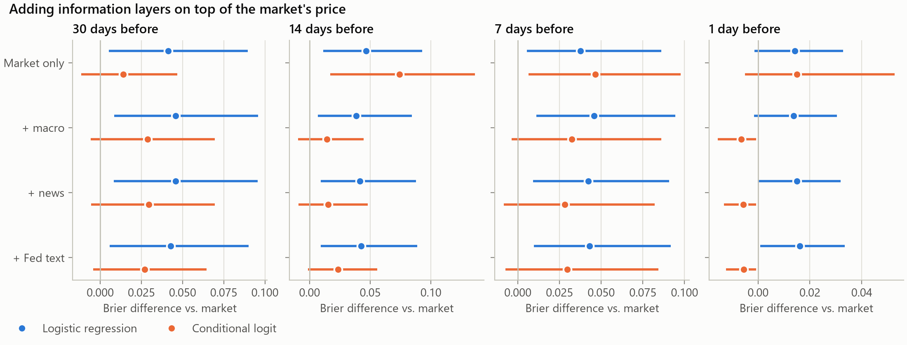
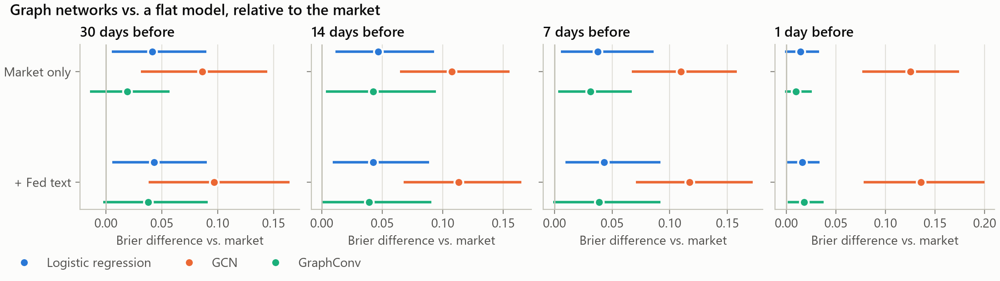

# Polymarket Resolution Information Layering

**Can anything beat the market on Fed decisions?** Polymarket runs a cluster of binary
markets on every FOMC meeting: "no change", "cut 25 bps", "hike 25+ bps", and so on.
Exactly one of them resolves YES. This project asks how much each layer of public
information adds on top of the market's own price when forecasting which one: macro data,
news coverage, the Fed's own statement text, and the network of traders shared across
markets. Every feature is computed point-in-time at 30, 14, 7, and 1 day before the
decision, and every model is scored walk-forward against the market.

**Stack:** Python · pandas · scikit-learn · PyTorch + PyTorch Geometric · Polymarket Gamma
API and Data API v2 · FRED/ALFRED · SF Fed News Sentiment · GDELT · federalreserve.gov

## Results

The test period covers 19 meetings, July 2024 to October 2026 (18 at the 30-day horizon). It
spans the start of the 2024 cuts, the 2025 holds and cuts, and the September 2026 hike.

- **The market is the forecaster to beat, and it is very good.** Out of sample, its normalized
  price picks the winning bucket at 83% of meetings a month out and at 100% the night before
  (Brier 0.054 → 0.008). Picking a bucket at random scores 0.17.
- **No information layer beats it 30, 14, or 7 days out.** Every model that adds macro data,
  news, or Fed text to the market's price scores worse than the price alone.
- **The one reliable gain is one day out, and it is calibration.** A conditional logit that
  combines the price with the rates-implied policy path cuts the Brier score by 0.0065 (95%
  interval 0.0008 to 0.0155) and log loss by about two-thirds (0.042 → 0.013). It gets
  there by sharpening calls the market already gets right. The night before a decision, the
  market still leaves about 2.5% on each losing bucket; the model's median probability on the
  winner is 0.995, against the market's 0.956.
- **Fundamentals alone carry real but limited signal.** Macro data alone picks the winner
  about two-thirds of the time (versus 5% by chance), far short of the market. News sentiment
  and statement text add nothing measurable at this sample size.
- **A graph network is only competitive when its convolution can express rivalry.** GCN
  collapses to "always hold": its favorite bucket is "hold" at every test meeting, so its
  top-1 accuracy is exactly the share of holds in the test period (63%). GraphConv keeps a
  separate weight for each node itself. It is significantly better than GCN at 7 and 1 days
  and statistically indistinguishable from the flat logistic regression. It does not beat the
  market. The trader network itself carries little label signal: overlap edges join two
  same-outcome markets at the rate random pairs do.

<picture>
  <source media="(prefers-color-scheme: dark)" srcset="reports/figures/layers_vs_market_dark.png">
  
</picture>

<details>
<summary>More figures</summary>

<picture>
  <source media="(prefers-color-scheme: dark)" srcset="reports/figures/market_by_horizon_dark.png">
  
</picture>

<picture>
  <source media="(prefers-color-scheme: dark)" srcset="reports/figures/fundamentals_only_dark.png">
  
</picture>

<picture>
  <source media="(prefers-color-scheme: dark)" srcset="reports/figures/graph_models_vs_market_dark.png">
  
</picture>

</details>

## How it works

```
Polymarket Gamma API ──► 31 FOMC meetings, 125 markets, labels checked against on-chain payouts
Polymarket Data API v2 ─► full price series + 2.97M trades (keyset pagination, no truncation)
FRED / ALFRED ──────────► rates (EFFR, 3m/6m/2y Treasuries, VIX) + first-release macro data
SF Fed ─────────────────► daily news sentiment          federalreserve.gov ─► FOMC statements
GDELT DOC API ──────────► daily coverage and tone timelines (resumable, throttle-aware)
        │
        ▼  every value carries an availability date; a feature at time t only sees what was public before t
point-in-time panel: one row per (market, horizon), horizons = 30 / 14 / 7 / 1 days
        │
        ├─► market graph at each forecast time: same meeting · adjacent meetings ·
        │   same kind of move · trader overlap (Jaccard over pre-forecast wallets)
        ▼
walk-forward by meeting (train on meetings already decided, test on the next one)
        ├─ baselines: uniform over buckets, raw and normalized market price
        ├─ logistic regression and conditional logit, layers added one at a time
        └─ GCN vs. GraphConv on the market graph
        ▼
Brier score, log loss, top-1 accuracy, and paired bootstrap intervals vs. the market
```

## Design decisions worth knowing

- **One forecast time per horizon, for every layer.** A forecast for horizon h is made at
  00:00 UTC on (decision date − h). Prices count once their observation window has closed,
  trades only if they happened before the forecast, daily FRED series from the day after
  publication, and revised macro releases (core CPI, core PCE, unemployment, claims, NFCI,
  industrial production) as ALFRED **first-release** values dated by publication, not by
  reference month. The last point matters: "January CPI as of January 15" did not exist yet.
- **The market price is the baseline to beat.** The market's normalized price is the
  reference forecast, and every model is scored by how much it improves on it (Brier score
  and log loss, which reward calibrated probabilities), not by raw accuracy.
- **Macro, news, and text enter through the bucket.** Those layers are identical for every
  market in a meeting, so on their own they cannot favor "cut" over "hold". Each one is
  interacted with the bucket's signed move (in 25 bp units) and a hold flag. The model can
  then learn, for example, that 3-month bills trading below the policy rate favor the cut
  buckets.
- **Mutual exclusivity is built in.** The conditional logit puts one softmax over each
  meeting's buckets (McFadden), so a meeting's probabilities always sum to one.
- **Walk-forward by meeting, scored per meeting.** Training only uses meetings decided before
  the forecast date. Confidence intervals resample meetings rather than markets, because
  the markets within a meeting are dependent: exactly one of them wins.
- **GCN vs. GraphConv is a hypothesis test, not a horse race.** Same-meeting edges join
  mutually exclusive outcomes, so they are heterophilous by construction. GCN averages a
  node with its neighbors, which pulls rivals together. GraphConv keeps a separate
  weight for the node itself, so it can learn "my rival looks like YES, so I am NO".
- **Complete trade histories.** Polymarket's v1 trades API stopped at 4,000 trades per market
  (about the last 9 days of a busy market). The v2 feed is keyset-paginated, and the
  collector merges it with a v1 cache for trades older than v2's three-year window, so all
  125 markets have full histories. Trader-overlap edges at a 30-day horizon are built from
  the wallets that had traded more than 30 days out.
- **Wallets are anonymized.** The committed snapshot replaces wallet addresses with integer
  codes ordered by SHA-256 hash. It keeps who-overlaps-with-whom and drops the addresses,
  usernames, and profile fields the API returns.

## Full results

Generated by `polylayers report` (`reports/results/summary.md`); per-market predictions are in
`reports/results/predictions.parquet`. In this run, GDELT was still throttled, so the news
layer is the SF Fed sentiment index alone.

**How good is the market?** Brier score (lower is better) and the share of meetings where the forecaster's favorite bucket won.

| Forecaster | 30d Brier | 30d top-1 | 14d Brier | 14d top-1 | 7d Brier | 7d top-1 | 1d Brier | 1d top-1 |
|---|---:|---:|---:|---:|---:|---:|---:|---:|
| Uniform over buckets | 0.172 | 6% | 0.173 | 5% | 0.173 | 5% | 0.173 | 5% |
| Market price | 0.054 | 83% | 0.024 | 95% | 0.022 | 95% | 0.008 | 100% |
| Market price (normalized) | 0.054 | 83% | 0.024 | 95% | 0.022 | 95% | 0.008 | 100% |
| Logistic regression · Macro + news + text | 0.155 | 61% | 0.156 | 63% | 0.164 | 63% | 0.134 | 63% |
| Conditional logit · Macro + news + text | 0.197 | 44% | 0.161 | 53% | 0.146 | 58% | 0.138 | 63% |

**Does anything improve on it?** Brier difference vs. the normalized market price, with a 95% interval from a meeting-level paired bootstrap (negative = better than the market).

| Forecaster | 30d | 14d | 7d | 1d |
|---|---:|---:|---:|---:|
| Logistic regression · Market only | +0.0413 [+0.0052, +0.0897] | +0.0466 [+0.0113, +0.0929] | +0.0377 [+0.0055, +0.0860] | +0.0143 [-0.0014, +0.0328] |
| Logistic regression · + macro | +0.0458 [+0.0084, +0.0959] | +0.0383 [+0.0069, +0.0844] | +0.0458 [+0.0112, +0.0945] | +0.0137 [-0.0016, +0.0304] |
| Logistic regression · + news | +0.0458 [+0.0082, +0.0955] | +0.0413 [+0.0092, +0.0878] | +0.0423 [+0.0092, +0.0908] | +0.0149 [-0.0001, +0.0319] |
| Logistic regression · + Fed text | +0.0429 [+0.0057, +0.0902] | +0.0424 [+0.0091, +0.0887] | +0.0431 [+0.0097, +0.0918] | +0.0162 [+0.0008, +0.0334] |
| Conditional logit · Market only | +0.0141 [-0.0115, +0.0469] | +0.0742 [+0.0169, +0.1364] | +0.0464 [+0.0065, +0.0976] | +0.0149 [-0.0051, +0.0527] |
| Conditional logit · + macro | +0.0287 [-0.0059, +0.0695] | +0.0143 [-0.0093, +0.0446] | +0.0324 [-0.0038, +0.0860] | -0.0065 [-0.0155, -0.0008] |
| Conditional logit · + news | +0.0295 [-0.0054, +0.0695] | +0.0153 [-0.0091, +0.0479] | +0.0282 [-0.0085, +0.0821] | -0.0058 [-0.0132, -0.0008] |
| Conditional logit · + Fed text | +0.0270 [-0.0042, +0.0647] | +0.0236 [-0.0013, +0.0559] | +0.0298 [-0.0076, +0.0844] | -0.0055 [-0.0124, -0.0008] |
| GCN · Market only | +0.0861 [+0.0314, +0.1445] | +0.1073 [+0.0646, +0.1553] | +0.1097 [+0.0673, +0.1583] | +0.1251 [+0.0766, +0.1742] |
| GCN · + Fed text | +0.0967 [+0.0382, +0.1643] | +0.1133 [+0.0675, +0.1648] | +0.1173 [+0.0705, +0.1721] | +0.1359 [+0.0780, +0.1999] |
| GraphConv · Market only | +0.0190 [-0.0144, +0.0571] | +0.0425 [+0.0034, +0.0944] | +0.0314 [+0.0033, +0.0669] | +0.0096 [-0.0015, +0.0255] |
| GraphConv · + Fed text | +0.0378 [-0.0026, +0.0912] | +0.0390 [-0.0001, +0.0905] | +0.0385 [-0.0011, +0.0920] | +0.0179 [+0.0015, +0.0376] |

**Where the market missed.** Counting all 31 meetings point-in-time, the market's favorite
lost at one horizon or more at four meetings:

- **Sep 2024, the 50 bp cut.** The market favored 25 bps at 30, 14, and 7 days.
- **Jun 2023, the hawkish "skip".** Fourteen days out, the market favored a hike; the Fed held.
- **Sep 2026.** Thirty days out, the market favored a hold, while 3-month bills already traded
  24 bp above the policy rate. The Fed hiked.
- **Oct 2026.** The reverse: bills and the market both leaned toward a hike, and the Fed held.

Full write-up, including what changed from my first version of this analysis:
[`docs/report.md`](docs/report.md).

## Reproduce

```bash
uv sync
uv run python -m polylayers evaluate   # walk-forward evaluation from data/snapshot/ (no API keys)
uv run python -m polylayers report     # figures in reports/figures/
uv run pytest
```

Rebuilding the data from the APIs (needs a free FRED key in `.env`; GDELT is throttled, and
the collector resumes where it stopped):

```bash
uv run python -m polylayers collect polymarket
uv run python -m polylayers collect fred
uv run python -m polylayers collect sf-fed
uv run python -m polylayers collect fomc
uv run python -m polylayers collect gdelt --max-hours 12
uv run python -m polylayers build
```

## Project layout

```
configs/default.toml        horizons, date range, GDELT pacing, walk-forward burn-in
src/polylayers/
  collect/                  polymarket, fred, sf_fed, fomc, gdelt (cached, rate-limited, resumable)
  features/                 as_of lookups, buckets, market, macro, news, text, panel assembly
  graph/                    edge construction, wallet table
  models/                   design matrices, baselines, logistic, conditional logit, GNNs
  evaluation/               walk-forward folds, scoring rules, meeting bootstrap, experiment runner
  reporting/                figures (light and dark) and generated summary tables
data/snapshot/              committed panel + anonymized wallet table
reports/                    results tables and figures
docs/report.md              full write-up
tests/                      unit tests (no network)
```

## Data sources

Polymarket (Gamma API, Data API v2) · FRED and ALFRED, Federal Reserve Bank of St. Louis ·
Daily News Sentiment Index, Federal Reserve Bank of San Francisco (Shapiro, Sudhof and
Wilson, 2022) · GDELT Project DOC 2.0 API · FOMC statements, Board of Governors of the
Federal Reserve System.

## License

MIT. Data remains subject to each provider's terms.
