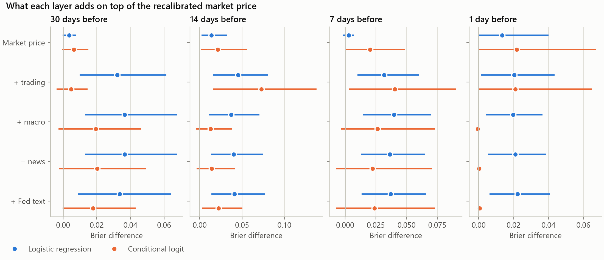
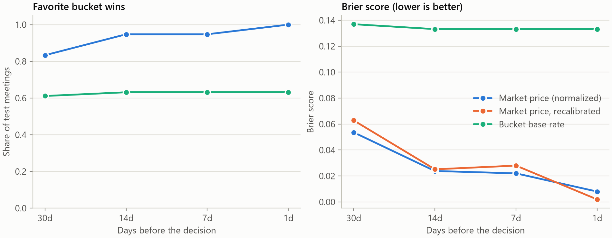
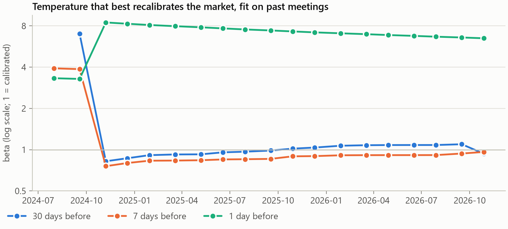
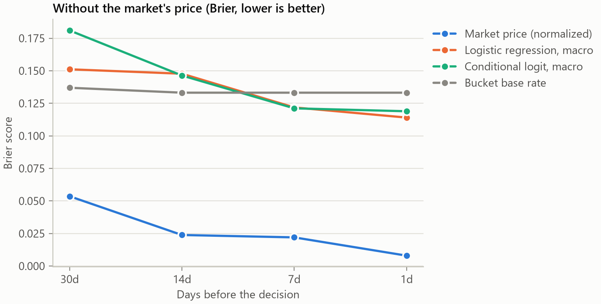
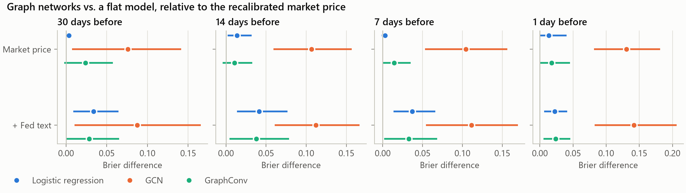

# Polymarket Resolution Information Layering

**Can anything beat the market on Fed decisions?** Polymarket runs a cluster of binary
markets on every FOMC meeting: "no change", "cut 25 bps", "hike 25+ bps", and so on.
Exactly one of them resolves YES. This project asks how much each layer of public
information adds on top of the market's own price when forecasting which one: macro data,
news coverage, the Fed's own statement text, and the network of traders shared across
markets. Every feature is computed point-in-time at 30, 14, 7, and 1 day before the
decision, and every model is scored walk-forward against the market.

**Stack:** Python · pandas · scikit-learn · PyTorch + PyTorch Geometric · Polymarket Gamma
API and Data API v2 · FRED/ALFRED · SF Fed News Sentiment · GDELT · federalreserve.gov

## Results

The test period covers 19 meetings, July 2024 to October 2026 (18 at the 30-day horizon). It
spans the start of the 2024 cuts, the 2025 holds and cuts, and the September 2026 hike.

- **The market is the forecaster to beat.** Out of sample, its normalized price picks the
  winning bucket at 83% of meetings a month out and at 100% the night before (Brier 0.054 →
  0.008). The naive baseline (how often each kind of move has won before, which amounts to
  "the Fed usually holds") picks 61–63%, with a Brier score of 0.13.
- **The market is calibrated, except the night before.** I fit a temperature walk-forward:
  the single parameter that best rescales the price. At 30, 14, and 7 days it is about 1,
  and rescaling doesn't help. One day out it is about 7: the market is strongly
  underconfident, still leaving about 2.5% on each losing bucket. Recalibrating cuts the
  1-day Brier score from 0.008 to 0.002 (difference −0.0060, 95% interval −0.0139 to
  −0.0008). That is the only improvement over the market I found.
- **No information layer adds anything.** Measured against the recalibrated price, adding
  trading activity makes models significantly worse at every horizon. Macro data adds nothing
  (at 1 day, −0.0005, interval −0.0019 to +0.0003). News sentiment and Fed statement text add
  nothing or slightly hurt.
- **Without the price, public data doesn't beat "the Fed usually holds".** Macro-only models
  are never significantly better than the bucket base rate, and adding news and text makes
  them worse.
- **GCN collapses, and the edges are why.** Full-graph GCN picks "hold" at every test
  meeting. Ablations locate the cause:
  - With no edges, GCN does as well as a flat model.
  - With only cross-meeting edges, it smooths every market toward its bucket's average and
    always picks hold.
  - With only same-meeting and trader edges, it averages rival buckets together and does
    worse than uniform.

  GraphConv keeps a separate weight for each node. It avoids the collapse but only matches a
  flat logistic regression, and does not beat the market. The trader network carries no
  outcome signal: overlap edges join two same-outcome markets at the rate random pairs do.

<picture>
  <source media="(prefers-color-scheme: dark)" srcset="reports/figures/layers_vs_recalibrated_market_dark.png">
  
</picture>

<details>
<summary>More figures</summary>

<picture>
  <source media="(prefers-color-scheme: dark)" srcset="reports/figures/market_by_horizon_dark.png">
  
</picture>

<picture>
  <source media="(prefers-color-scheme: dark)" srcset="reports/figures/market_temperature_dark.png">
  
</picture>

<picture>
  <source media="(prefers-color-scheme: dark)" srcset="reports/figures/fundamentals_only_dark.png">
  
</picture>

<picture>
  <source media="(prefers-color-scheme: dark)" srcset="reports/figures/graph_models_dark.png">
  
</picture>

</details>

## How it works

```
Polymarket Gamma API ──► 31 FOMC meetings, 125 markets, labels checked against on-chain payouts
Polymarket Data API v2 ─► full price series + 2.97M trades (keyset pagination, no truncation)
FRED / ALFRED ──────────► rates (EFFR, 3m/6m/2y Treasuries, VIX) + first-release macro data
SF Fed ─────────────────► daily news sentiment          federalreserve.gov ─► FOMC statements
GDELT DOC API ──────────► daily coverage and tone timelines (resumable, throttle-aware)
        │
        ▼  every value carries an availability date; a feature at time t only sees what was public before t
point-in-time panel: one row per (market, horizon), horizons = 30 / 14 / 7 / 1 days
        │
        ├─► market graph at each forecast time: same meeting · adjacent meetings ·
        │   same kind of move · trader overlap (Jaccard over pre-forecast wallets)
        ▼
walk-forward by meeting (train on meetings already decided, test on the next one)
        ├─ baselines: uniform, bucket base rate, raw / normalized / recalibrated market price
        ├─ logistic regression and conditional logit, layers added one at a time
        └─ GCN vs. GraphConv on the market graph, plus GCN edge ablations
        ▼
Brier score, log loss, top-1 accuracy, and paired bootstrap intervals vs. the recalibrated market
```

## Design decisions worth knowing

- **One forecast time per horizon, for every layer.** A forecast for horizon h is made at
  00:00 UTC on (decision date − h). Prices count once their observation window has closed,
  trades only if they happened before the forecast, daily FRED series from the day after
  publication, and revised macro releases (core CPI, core PCE, unemployment, claims, NFCI,
  industrial production) as ALFRED **first-release** values dated by publication, not by
  reference month. The last point matters: "January CPI as of January 15" did not exist yet.
- **The recalibrated market price is the baseline to beat.** A model can beat the raw price
  just by fixing its calibration, so the reference is the price temperature-scaled with
  one parameter fit on past meetings. Every layer is scored by how much it improves on that
  (Brier score and log loss, which reward calibrated probabilities), not by raw accuracy.
  Models that never see the price face the bucket base rate instead: how often each kind of
  move has won before.
- **Macro, news, and text enter through the bucket.** Those layers are identical for every
  market in a meeting, so on their own they cannot favor "cut" over "hold". Each one is
  interacted with the bucket's signed move (in 25 bp units) and a hold flag. The model can
  then learn, for example, that 3-month bills trading below the policy rate favor the cut
  buckets.
- **Trading activity is its own layer.** Wallet counts, volume, and net YES flow are tested
  separately from the price, so the trader layer gets its own measurement.
- **Mutual exclusivity is built in.** The conditional logit puts one softmax over each
  meeting's buckets (McFadden), so a meeting's probabilities always sum to one.
- **Walk-forward by meeting, scored per meeting.** Training only uses meetings decided before
  the forecast date. Confidence intervals resample meetings rather than markets, because
  the markets within a meeting are dependent: exactly one of them wins.
- **GCN vs. GraphConv, with ablations to explain the gap.** GCN averages a node with its
  neighbors through one shared weight. GraphConv keeps a separate weight for the node
  itself. Rerunning GCN on parts of the graph (no edges, cross-meeting edges only, rival
  and trader edges only) shows which edges break it.
- **Complete trade histories.** Polymarket's v1 trades API stopped at 4,000 trades per market
  (about the last 9 days of a busy market). The v2 feed is keyset-paginated, and the
  collector merges it with a v1 cache for trades older than v2's three-year window, so all
  125 markets have full histories. Trader-overlap edges at a 30-day horizon are built from
  the wallets that had traded more than 30 days out.
- **Wallets are anonymized.** The committed snapshot replaces wallet addresses with integer
  codes ordered by SHA-256 hash. It keeps who-overlaps-with-whom and drops the addresses,
  usernames, and profile fields the API returns.

## Full results

Generated by `polylayers report` (`reports/results/summary.md`). Per-market predictions are in
`reports/results/predictions.parquet`. In this run GDELT was still throttled, so the news
layer is the SF Fed sentiment index alone.

**How good is the market?** Brier score (lower is better) and the share of test meetings where the forecaster's favorite bucket won.

| Forecaster | 30d Brier | 30d top-1 | 14d Brier | 14d top-1 | 7d Brier | 7d top-1 | 1d Brier | 1d top-1 |
|---|---:|---:|---:|---:|---:|---:|---:|---:|
| Uniform over buckets | 0.172 | 6% | 0.173 | 5% | 0.173 | 5% | 0.173 | 5% |
| Bucket base rate | 0.137 | 61% | 0.133 | 63% | 0.133 | 63% | 0.133 | 63% |
| Market price | 0.054 | 83% | 0.024 | 95% | 0.022 | 95% | 0.008 | 100% |
| Market price (normalized) | 0.054 | 83% | 0.024 | 95% | 0.022 | 95% | 0.008 | 100% |
| Market price, recalibrated | 0.063 | 83% | 0.025 | 95% | 0.028 | 95% | 0.002 | 100% |

**Is the market calibrated?** The temperature (beta) that best recalibrates the normalized price, fit walk-forward on past meetings (beta > 1: the market was underconfident), and what the recalibration gains over the raw price.

| | 30d | 14d | 7d | 1d |
|---|---:|---:|---:|---:|
| Median fitted temperature (beta) | 1.00 | 0.85 | 0.90 | 7.18 |
| Recalibrated minus raw market, Brier | +0.0092 [-0.0098, +0.0355] | +0.0013 [-0.0069, +0.0152] | +0.0060 [-0.0057, +0.0276] | -0.0060 [-0.0139, -0.0008] |

**Does any layer add information?** Brier difference vs. the recalibrated market price, with a 95% interval from a meeting-level paired bootstrap (negative = better than the recalibrated market).

| Forecaster | 30d | 14d | 7d | 1d |
|---|---:|---:|---:|---:|
| Logistic regression · Market price | +0.0036 [-0.0003, +0.0078] | +0.0137 [+0.0022, +0.0322] | +0.0029 [-0.0017, +0.0074] | +0.0134 [+0.0002, +0.0401] |
| Logistic regression · + trading | +0.0321 [+0.0099, +0.0614] | +0.0453 [+0.0157, +0.0803] | +0.0317 [+0.0101, +0.0599] | +0.0203 [+0.0013, +0.0435] |
| Logistic regression · + macro | +0.0366 [+0.0131, +0.0676] | +0.0370 [+0.0114, +0.0707] | +0.0398 [+0.0142, +0.0697] | +0.0198 [+0.0044, +0.0366] |
| Logistic regression · + news | +0.0366 [+0.0130, +0.0675] | +0.0400 [+0.0136, +0.0749] | +0.0363 [+0.0129, +0.0651] | +0.0210 [+0.0054, +0.0389] |
| Logistic regression · + Fed text | +0.0337 [+0.0089, +0.0643] | +0.0411 [+0.0139, +0.0768] | +0.0371 [+0.0134, +0.0660] | +0.0222 [+0.0062, +0.0410] |
| Conditional logit · Market price | +0.0064 [-0.0006, +0.0150] | +0.0213 [+0.0012, +0.0560] | +0.0202 [+0.0008, +0.0487] | +0.0219 [+0.0001, +0.0671] |
| Conditional logit · + trading | +0.0048 [-0.0039, +0.0146] | +0.0729 [+0.0159, +0.1378] | +0.0404 [+0.0030, +0.0903] | +0.0210 [+0.0000, +0.0649] |
| Conditional logit · + macro | +0.0195 [-0.0027, +0.0463] | +0.0130 [-0.0042, +0.0386] | +0.0264 [-0.0035, +0.0730] | -0.0005 [-0.0019, +0.0003] |
| Conditional logit · + news | +0.0203 [-0.0026, +0.0493] | +0.0140 [-0.0035, +0.0418] | +0.0223 [-0.0076, +0.0708] | +0.0003 [+0.0000, +0.0007] |
| Conditional logit · + Fed text | +0.0178 [-0.0003, +0.0431] | +0.0223 [+0.0029, +0.0505] | +0.0238 [-0.0075, +0.0733] | +0.0006 [+0.0000, +0.0015] |
| GCN · Market price | +0.0758 [+0.0073, +0.1416] | +0.1065 [+0.0592, +0.1568] | +0.1043 [+0.0531, +0.1563] | +0.1306 [+0.0816, +0.1814] |
| GCN · + Fed text | +0.0875 [+0.0103, +0.1656] | +0.1120 [+0.0608, +0.1662] | +0.1114 [+0.0543, +0.1697] | +0.1419 [+0.0828, +0.2062] |
| GraphConv · Market price | +0.0238 [-0.0023, +0.0576] | +0.0105 [-0.0040, +0.0326] | +0.0143 [-0.0000, +0.0351] | +0.0177 [-0.0000, +0.0452] |
| GraphConv · + Fed text | +0.0286 [+0.0003, +0.0651] | +0.0377 [+0.0043, +0.0787] | +0.0326 [+0.0018, +0.0683] | +0.0239 [+0.0054, +0.0461] |

**Without the market's price.** Fundamentals-only models vs. the bucket base rate (how often each kind of move has won before): Brier difference with 95% interval.

| Forecaster vs. bucket base rate | 30d | 14d | 7d | 1d |
|---|---:|---:|---:|---:|
| Logistic regression · Macro | +0.0142 [-0.0042, +0.0362] | +0.0146 [-0.0087, +0.0407] | -0.0113 [-0.0424, +0.0201] | -0.0191 [-0.0543, +0.0147] |
| Logistic regression · Macro + news + text | +0.0184 [+0.0017, +0.0373] | +0.0228 [-0.0004, +0.0489] | +0.0313 [+0.0043, +0.0603] | +0.0010 [-0.0320, +0.0356] |
| Conditional logit · Macro | +0.0440 [+0.0053, +0.0849] | +0.0132 [-0.0215, +0.0482] | -0.0120 [-0.0592, +0.0370] | -0.0143 [-0.0704, +0.0456] |
| Conditional logit · Macro + news + text | +0.0598 [+0.0101, +0.1080] | +0.0281 [-0.0144, +0.0733] | +0.0129 [-0.0252, +0.0526] | +0.0051 [-0.0410, +0.0539] |

**What breaks GCN?** GCN on subsets of the graph, with market price features.

| Model (market price features) | 30d Brier · top-1 · favorite=hold | 14d Brier · top-1 · favorite=hold | 7d Brier · top-1 · favorite=hold | 1d Brier · top-1 · favorite=hold |
|---|---:|---:|---:|---:|
| GCN | 0.139 · 61% · 100% | 0.132 · 63% · 100% | 0.132 · 63% · 100% | 0.133 · 63% · 100% |
| GCN, no edges | 0.085 · 78% · 61% | 0.038 · 89% · 63% | 0.048 · 89% · 63% | 0.017 · 95% · 63% |
| GCN, cross-meeting edges only | 0.146 · 61% · 100% | 0.141 · 63% · 100% | 0.141 · 63% · 100% | 0.141 · 63% · 100% |
| GCN, same-meeting + trader edges only | 0.180 · 28% · 17% | 0.175 · 32% · 21% | 0.175 · 37% · 21% | 0.173 · 32% · 26% |
| GraphConv | 0.087 · 78% · 61% | 0.036 · 89% · 63% | 0.042 · 95% · 63% | 0.020 · 95% · 63% |

**Where the market missed.** Counting all 31 meetings point-in-time, the market's favorite
lost at one horizon or more at four meetings:

- **Sep 2024, the 50 bp cut.** The market favored 25 bps at 30, 14, and 7 days.
- **Jun 2023, the hawkish "skip".** Fourteen days out, the market favored a hike; the Fed held.
- **Sep 2026.** Thirty days out, the market favored a hold, while 3-month bills already traded
  24 bp above the policy rate. The Fed hiked.
- **Oct 2026.** The reverse: bills and the market both leaned toward a hike, and the Fed held.

Full write-up, including what changed from my first version of this analysis:
[`docs/report.md`](docs/report.md).

## Reproduce

```bash
uv sync
uv run python -m polylayers evaluate   # walk-forward evaluation from data/snapshot/ (no API keys)
uv run python -m polylayers report     # figures in reports/figures/
uv run pytest
```

Rebuilding the data from the APIs (needs a free FRED key in `.env`; GDELT is throttled, and
the collector resumes where it stopped):

```bash
uv run python -m polylayers collect polymarket
uv run python -m polylayers collect fred
uv run python -m polylayers collect sf-fed
uv run python -m polylayers collect fomc
uv run python -m polylayers collect gdelt --max-hours 12
uv run python -m polylayers build
```

## Project layout

```
configs/default.toml        horizons, date range, GDELT pacing, walk-forward burn-in
src/polylayers/
  collect/                  polymarket, fred, sf_fed, fomc, gdelt (cached, rate-limited, resumable)
  features/                 as_of lookups, buckets, market, macro, news, text, panel assembly
  graph/                    edge construction, wallet table
  models/                   design matrices, baselines, logistic, conditional logit, GNNs
  evaluation/               walk-forward folds, scoring rules, meeting bootstrap, experiment runner
  reporting/                figures (light and dark) and generated summary tables
data/snapshot/              committed panel + anonymized wallet table
reports/                    results tables and figures
docs/report.md              full write-up
tests/                      unit tests (no network)
```

## Data sources

Polymarket (Gamma API, Data API v2) · FRED and ALFRED, Federal Reserve Bank of St. Louis ·
Daily News Sentiment Index, Federal Reserve Bank of San Francisco (Shapiro, Sudhof and
Wilson, 2022) · GDELT Project DOC 2.0 API · FOMC statements, Board of Governors of the
Federal Reserve System.

## License

MIT. Data remains subject to each provider's terms.
